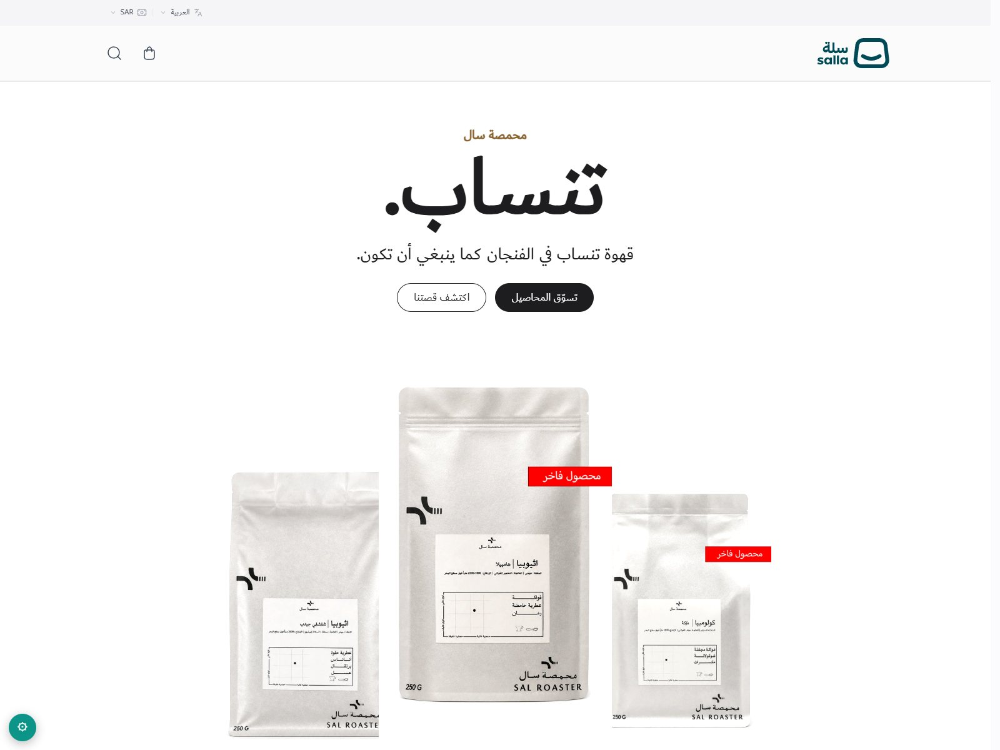
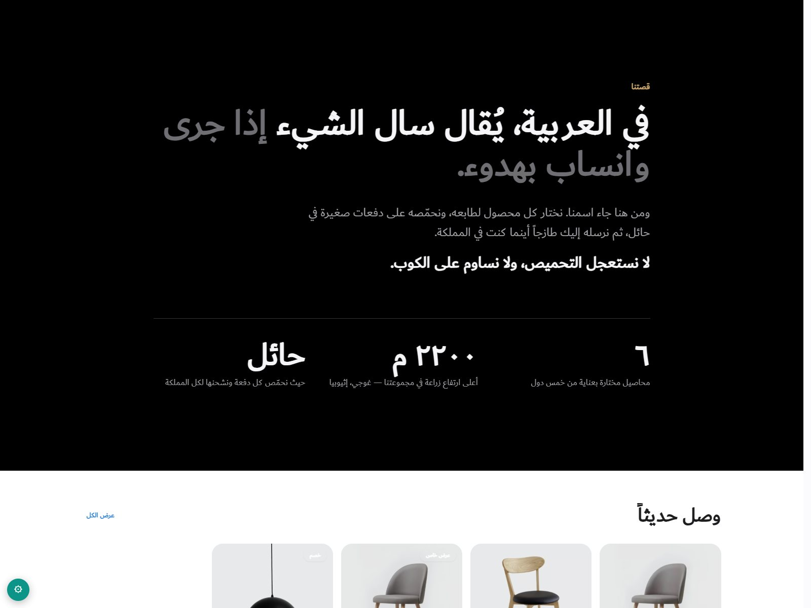
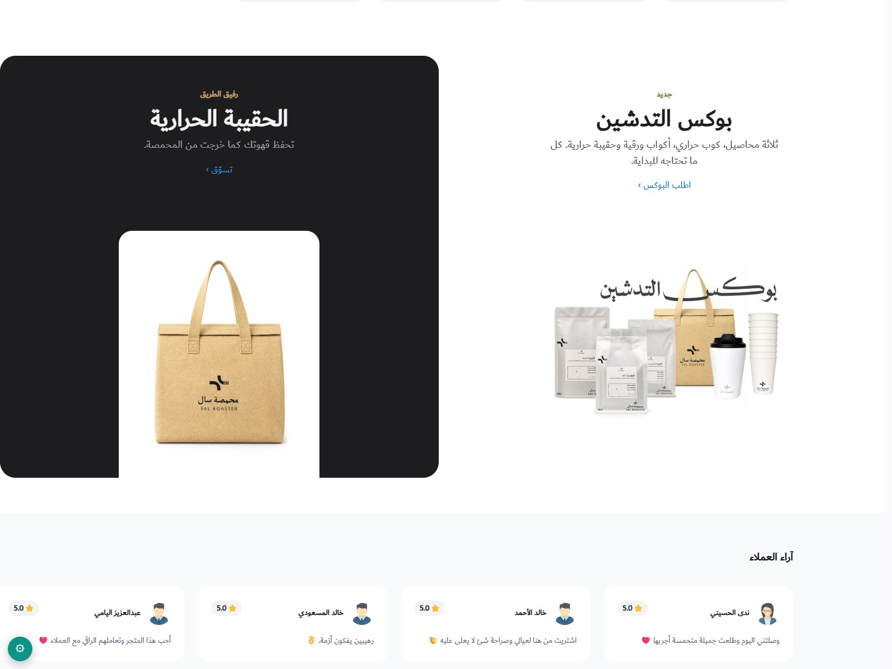
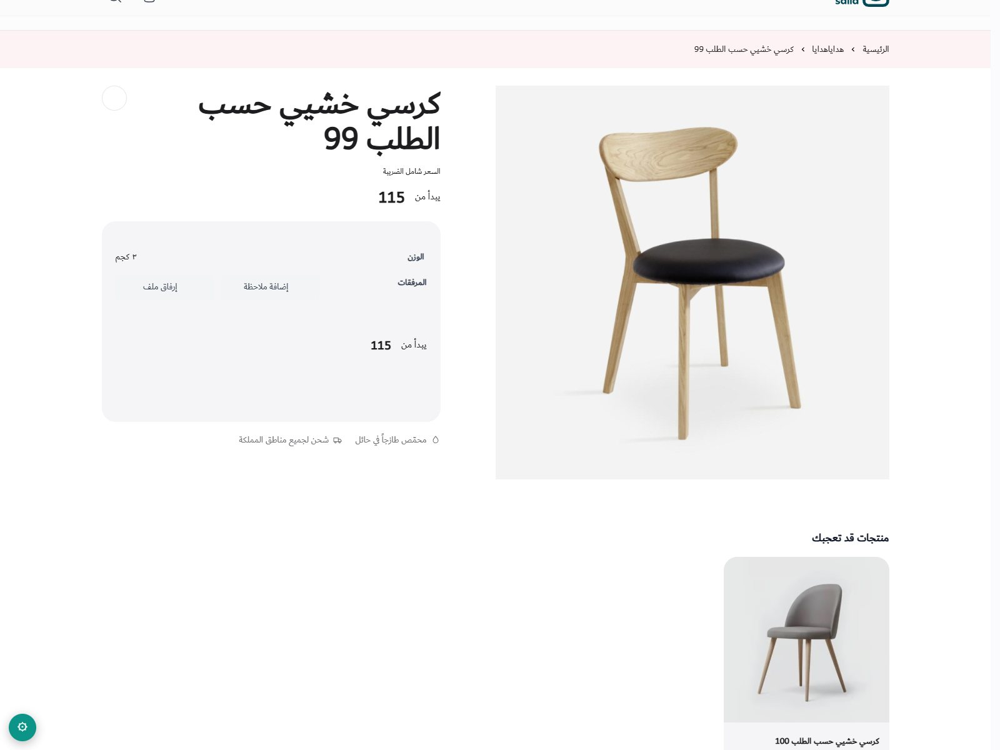

# دليل ثيم تنساب

تنساب ثيم أنيق مستوحى من آبل لمتاجر سلة: واجهة افتتاحية سينمائية، قسم لقصة متجرك، بطاقات ترويجية كبيرة، وصفحات منتج وسلة مرتبة. هذا الدليل يشرح تفعيله وتخصيصه خطوة بخطوة.

## التثبيت

بعد شراء الثيم من متجر ثيمات سلة، يظهر في لوحة تحكم متجرك ويحتاج تفعيلاً واحداً.

1. من لوحة التحكم افتح **المظهر ← الثيمات**.
2. اختر **تنساب** واضغط **تفعيل**. يمكنك معاينته أولاً قبل التفعيل.
3. اضغط **تخصيص** لفتح محرر الثيم، ومنه ترتّب أقسام الصفحة الرئيسية وتعدّل نصوصها وصورها.
4. من **المظهر ← الألوان** اختر اللون الأساسي. ننصح بالأسود `#1D1D1F` ليطابق تصميم الثيم.

## أقسام الصفحة الرئيسية

يضيف الثيم ثلاثة أقسام خاصة بجانب أقسام سلة المعتادة (شرائح المنتجات، المنتجات الثابتة، آراء العملاء). تجدها في المحرر عبر **إضافة عنصر جديد**.

| القسم | ماذا يعرض | الحقول |
| --- | --- | --- |
| الواجهة الرئيسية | عنوان ضخم وزرّان وحتى 3 صور منتجات تظهر بحركة ناعمة | سطر علوي، عنوان، نص توضيحي، نص ورابط لكل زر، الصور |
| قصتنا | قسم داكن بعنوان بلونين ونص وسطر ختامي وحتى 4 أرقام بارزة | عنوان صغير، جزء أبيض وجزء رمادي من العنوان، النص، الأرقام ووصفها |
| بطاقات كبيرة | حتى 4 بطاقات ترويجية فاتحة أو داكنة مع صورة منتج أسفلها | سطر علوي، عنوان، نص، نص الرابط والرابط، الصورة، بطاقة داكنة |

النصوص تدعم العربية والإنجليزية. إذا تركت رابط زر الواجهة فارغاً ينزل الزائر للقسم التالي، والزر الثاني ينزل إلى قسم «قصتنا».

## إعدادات الثيم

من محرر الثيم ← **الإعدادات**:

- **سطرا الطمأنة تحت زر الشراء:** جملتان قصيرتان تظهران في صفحة المنتج (مثل مكان التحميص ومناطق الشحن). اترك الحقل فارغاً لإخفائه.
- **معلومات المتجر أسفل الشريط الرئيسي:** مطفأة افتراضياً لأن الواجهة الرئيسية تغني عنها.
- **الخط:** يستخدم الثيم IBM Plex Sans Arabic، ويمكن تغييره من إعدادات خطوط المتجر.
- باقي الإعدادات (تثبيت القائمة، مسار التنقل، زر الشراء الثابت في الجوال) تعمل كما في ثيمات سلة المعتادة.

## نصائح ودعم

- **صور المنتجات:** استخدم صوراً بخلفية بيضاء، فالثيم يذيبها في خلفيات البطاقات الرمادية. المقاس المناسب لصور الواجهة طولي، مثل 507×900 بكسل.
- **الجوال:** كل الأقسام تترتب عمودياً تلقائياً على الشاشات الصغيرة.
- **الدعم:** راسلنا على abo.azooz00@hotmail.com أو واتساب [966543004402](https://wa.me/966543004402).

